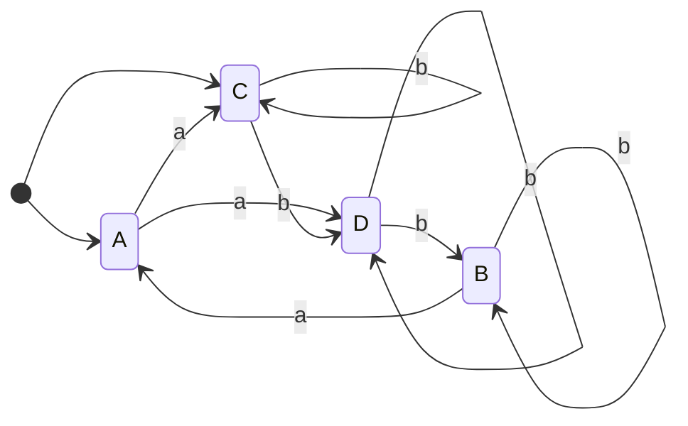
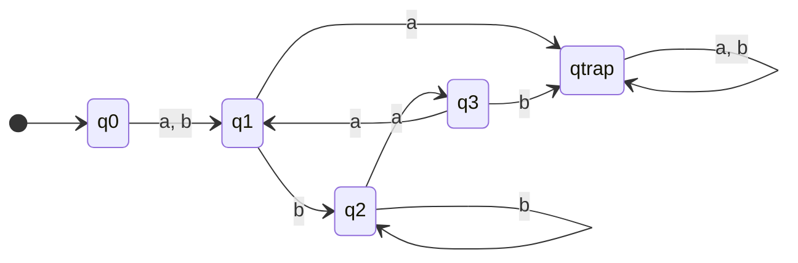

# Exercise 2: Automata Determinization, Complement Automaton $K$, and Formal Language

## 1. Problem Statement

Given an automaton $\mathcal{A}$ with:
* **States**: $S = \{A, B, C, D\}$
* **Alphabet**: $\Sigma = \{a, b\}$
* **Initial States**: $I = \{A, C\}$
* **Final States**: $F = \{B, D\}$
* **Transitions**:
  $$T = \{ (A,a,C), (A,a,D), (B,a,A), (B,b,B), (C,b,C), (C,b,D), (D,b,D), (D,b,B) \}$$

---

## 2. Automaton $\mathcal{A}$ (Original NFA)

$\mathcal{A}$ is a **Non-Deterministic Finite Automaton (NFA)** due to multiple initial states ($\{A, C\}$) and non-deterministic branching on identical inputs.

### State Transition Diagram ($\mathcal{A}$):

---

## 3. Determinization via Subset Construction (Powerset Construction)

To construct the exact complement automaton $K$, the NFA $\mathcal{A}$ must first be converted into a **complete Deterministic Finite Automaton (DFA)**.

### Step-by-Step Construction:

1. **Initial State**:
   $$q_0 = \{A, C\}$$
   *Final state test*: $\{A, C\} \cap \{B, D\} = \emptyset \implies$ **Non-Final**

2. **Transitions from $q_0 = \{A, C\}$**:
   * On $a$: $\delta(A, a) \cup \delta(C, a) = \{C, D\} \cup \emptyset = \mathbf{\{C, D\} = q_1}$
   * On $b$: $\delta(A, b) \cup \delta(C, b) = \emptyset \cup \{C, D\} = \mathbf{\{C, D\} = q_1}$

3. **Transitions from $q_1 = \{C, D\}$**:
   * On $a$: $\delta(C, a) \cup \delta(D, a) = \emptyset \cup \emptyset = \mathbf{\emptyset = q_\text{trap}}$
   * On $b$: $\delta(C, b) \cup \delta(D, b) = \{C, D\} \cup \{B, D\} = \mathbf{\{B, C, D\} = q_2}$
   * *Final state test*: $\{C, D\} \cap \{B, D\} = \{D\} \neq \emptyset \implies$ **Final in $\mathcal{A}$**

4. **Transitions from $q_2 = \{B, C, D\}$**:
   * On $a$: $\delta(B, a) \cup \delta(C, a) \cup \delta(D, a) = \{A\} \cup \emptyset \cup \emptyset = \mathbf{\{A\} = q_3}$
   * On $b$: $\delta(B, b) \cup \delta(C, b) \cup \delta(D, b) = \{B\} \cup \{C, D\} \cup \{B, D\} = \mathbf{\{B, C, D\} = q_2}$
   * *Final state test*: $\{B, C, D\} \cap \{B, D\} = \{B, D\} \neq \emptyset \implies$ **Final in $\mathcal{A}$**

5. **Transitions from $q_3 = \{A\}$**:
   * On $a$: $\delta(A, a) = \mathbf{\{C, D\} = q_1}$
   * On $b$: $\delta(A, b) = \mathbf{\emptyset = q_\text{trap}}$
   * *Final state test*: $\{A\} \cap \{B, D\} = \emptyset \implies$ **Non-Final**

6. **Transitions from Dead / Trap State $q_\text{trap} = \emptyset$**:
   * On $a$: $\mathbf{\emptyset = q_\text{trap}}$
   * On $b$: $\mathbf{\emptyset = q_\text{trap}}$
   * *Final state test*: $\emptyset \cap \{B, D\} = \emptyset \implies$ **Non-Final**

---

## 4. Construction of the Complement Automaton $K$

The complement automaton $K$ accepts the language $L(K) = \overline{L(\mathcal{A})} = \Sigma^* \setminus L(\mathcal{A})$.
Inverting the final states of the complete DFA yields:
$$F_K = S_\text{DFA} \setminus F_\text{DFA} = \{q_0, q_3, q_\text{trap}\}$$

### DFA Transition Table:

| DFA State | Subset of $\mathcal{A}$ | on $a$ | on $b$ | $\mathcal{A}$ (Original) | $K$ (Complement) |
| :--- | :--- | :---: | :---: | :---: | :---: |
| $\to \mathbf{q_0}$ | $\{A, C\}$ | $q_1$ | $q_1$ | Non-Final | **FINAL ($\in F_K$)** |
| $\mathbf{q_1}$ | $\{C, D\}$ | $q_\text{trap}$ | $q_2$ | **Final** | Non-Final |
| $\mathbf{q_2}$ | $\{B, C, D\}$ | $q_3$ | $q_2$ | **Final** | Non-Final |
| $\mathbf{q_3}$ | $\{A\}$ | $q_1$ | $q_\text{trap}$ | Non-Final | **FINAL ($\in F_K$)** |
| $\mathbf{q_\text{trap}}$ | $\emptyset$ | $q_\text{trap}$ | $q_\text{trap}$ | Non-Final | **FINAL ($\in F_K$)** |

---

### State Transition Diagram of $K$ (Complement DFA):

---

## 5. Formal Language Accepted by $K$ ($L(K) = \overline{L(\mathcal{A})}$)

The language $L(K)$ consists of all words $w \in \{a, b\}^*$ rejected by $\mathcal{A}$.

### Formal Characterization:
A word $w \in \{a, b\}^*$ belongs to $L(K)$ if and only if it satisfies **at least one** of the following conditions:

1. **The Empty Word**:
   $$w = \varepsilon$$
   *(Since $q_0 = \{A, C\}$ contains no accepting states of $\mathcal{A}$).*

2. **Immediate Subsequent $a$ at start or after 1 letter**:
   $$w \in \{aa, ba\}\Sigma^*$$
   *(From $q_0 \xrightarrow{a, b} q_1$, an immediate $a$ enters $q_\text{trap}$).*

3. **Subword containing $b^+ a b$**:
   Any word containing the substring:
   $$b^+ a b$$
   *(From $q_2 \xrightarrow{a} q_3 \xrightarrow{b} q_\text{trap}$).*

4. **Three Consecutive $a$'s**:
   Any word containing:
   $$aaa$$
   *(From $q_2 \xrightarrow{a} q_3 \xrightarrow{a} q_1 \xrightarrow{a} q_\text{trap}$).*

5. **Words ending on an odd isolated $a$**:
   Any word ending in state $q_3 = \{A\}$, matching the regular pattern:
   $$(a \mid b) b^+ (aa b^+)^* a$$
