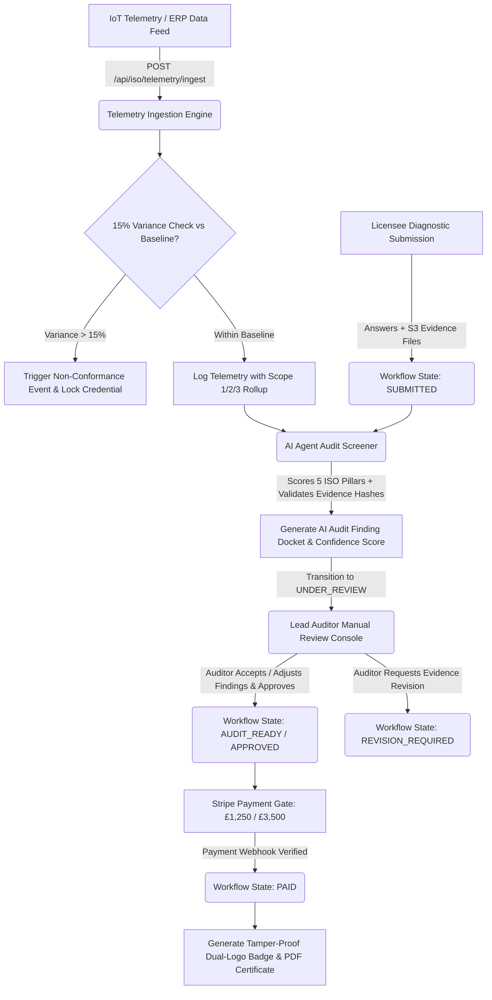

# Workflow 1: GHG Protocol & ISO Audit-Ready Pipeline

## 1. Executive Summary & Regulatory Foundation
This workflow delivers an end-to-end continuous carbon assurance pipeline adhering to:
- **GHG Protocol Corporate Standard** (Scope 1 Direct, Scope 2 Indirect Energy, Scope 3 Value Chain)
- **ISO 14064-1:2018** (Specification with guidance at the organization level for quantification and reporting of greenhouse gas emissions and removals)
- **ISO 50001:2018** (Energy management systems - Requirements with guidance for use)
- **ISO 19011:2018** (Guidelines for auditing management systems - specifically Annex A remote audit methodologies)
- **UK SECR** (Streamlined Energy and Carbon Reporting under Companies Act 2006)

---

## 2. Current Source Code Audit & Identified Gaps

| Subsystem | Existing File | Current Implementation | Production-Ready Gap to Close |
| :--- | :--- | :--- | :--- |
| **Telemetry Ingestion** | [`iso-telemetry.route.ts`](file:///Users/mac/ghg_app/src/routes/iso-telemetry.route.ts) | Basic reading log with anomaly check | Missing explicit `ghgScope` enum (`SCOPE_1`, `SCOPE_2`, `SCOPE_3`), emission factor (`kgCO2e/unit`), and automated Scope roll-up |
| **Asset Calibration** | [`iso-calibration.service.ts`](file:///Users/mac/ghg_app/src/services/iso-calibration.service.ts) | SHA-256 hash checks on PDF certs | Needs automatic expiration blocking: telemetry from expired sensor must trigger `422 Uncalibrated Sensor` |
| **Anomaly Engine** | [`anomaly-detection.service.ts`](file:///Users/mac/ghg_app/src/services/anomaly-detection.service.ts) | 15% threshold check against baseline | Non-conformance log exists, but must trigger cryptographic lock (`HTTP 423 Locked`) preventing export until auditor sign-off |
| **AI Audit Reviewer** | [`review-dispatcher.service.ts`](file:///Users/mac/ghg_app/src/services/review-pipeline/review-dispatcher.service.ts) | `StandardAuditReviewer` returns hardcoded 92 score | **Zero AI logic currently.** Must integrate autonomous LLM evaluator to score evidence, verify clauses, and prepare Lead Auditor docket |
| **Manual Auditor Gate** | [`ReviewDispatcherService`](file:///Users/mac/ghg_app/src/services/review-pipeline/review-dispatcher.service.ts#L109-L136) | Updates `IsoReadinessStatus` to `AUDIT_READY` | Needs side-by-side evidence preview, AI rationale review, clause override capabilities, and digital signature sign-off |
| **Checkout & Lock** | [`checkout.service.ts`](file:///Users/mac/ghg_app/src/services/checkout.service.ts) | Stripe Checkout session creation | Transition to `PAID` triggers badge generation and unlocks Gate 2 |

---

## 3. End-to-End Workflow Architecture

---

## 4. Detailed Feature Breakdown (Implementation Checklist)

### 4.1 Telemetry & Sensor Calibration Ingestion
- [x] **Schema Migration**: Added `ghgScope` (`SCOPE_1`, `SCOPE_2`, `SCOPE_3`), `activityAmount`, `unitOfMeasure`, `emissionFactorKgCo2PerUnit`, and `calculatedKgCo2e` to `TelemetryLog` in Prisma schema & applied database migration.
- [x] **Sensor Validation Gate**: Reject telemetry with HTTP 422 if the sensor's `AssetCalibrationRecord.expiryDate < NOW()` or `isCurrentlyValid == false` via `iso-calibration.service.ts` and `iso-telemetry.route.ts`.
- [x] **Automated Anomaly Lockout**: When variance exceeds 15% vs trailing baseline:
  - Generate `NonConformanceEvent` record with ISO clause reference (`ISO 50001:2018 Clause 9.1.1`).
  - Flag licensee account as `LOCKED_PENDING_SUPERVISOR`.
  - Block report exports with `HTTP 423 Locked` in `iso-pdf-report.service.ts` and `iso-evidence.route.ts` (tested and verified).

### 4.2 AI Agent Audit Screening Engine (`AiAuditReviewer`)
- [x] **Agent Architecture**: Implemented multi-provider `AiAuditReviewer` implementing `IAuditReviewer` interface in [`ai-audit-reviewer.service.ts`](file:///Users/mac/ghg_app/src/services/review-pipeline/ai-audit-reviewer.service.ts) supporting Gemini 1.5 Pro, Anthropic Claude 3.5 Sonnet, and OpenAI GPT-4o with deterministic rule engine fallback.
- [x] **Evidence & Clause Evaluation**:
  - Evaluates questionnaire responses against ISO 14064-1, ISO 50001, and GHG Protocol standards.
  - Inspects attached evidence document metadata, cryptographic SHA-256 hash integrity, and textual alignment.
  - Produces structured JSON findings with compliance score, recommended decision, and clause findings docket.
- [x] **State Machine Integration**: Transition status from `SUBMITTED` to `AI_SCREENED`, recording `WorkflowTransitionLog` with `triggeredBy: "AI_AGENT_ASSURANCE_ENGINE"` via `POST /api/workflow/submissions/:id/ai-screen` (triggered autonomously upon submission).

### 4.3 Lead Auditor Manual Review Console
- [x] **Auditor Queue View**: High-density enterprise dashboard in [`AdminPage.tsx`](file:///Users/mac/ghg_app/src/pages/AdminPage.tsx) displaying submissions awaiting review, sorted by submission date and AI confidence score.
- [x] **Side-by-Side Review Workspace**:
  - Diagnostic answers, attached evidence documents with SHA-256 digests.
  - Section 2b: AI Assurance Agent Screening Docket with clause-by-clause matrix, confidence indicators, and on-demand re-screening.
- [x] **Digital Sign-Off**: Lead Auditor supplies formal auditor credentials (`leadAuditorName`, `leadAuditorAccreditation`) and cryptographic attestation signature under ISO 19011:2018 statutory guidelines.

### 4.4 Payment Gate & Dual-Logo Certification
- [x] **Stripe Checkout Webhook**: In [`webhooks.stripe.ts`](file:///Users/mac/ghg_app/src/routes/webhooks.stripe.ts), on `checkout.session.completed`, advance status from `APPROVED` to `PAID`.
- [x] **Dual-Logo Composite Engine**: High-resolution audit seal compositing the GHG Emission Logs platform crest with the licensee's verified corporate logo via `credentials.route.ts` and `workflow.route.ts` Screen 8.
- [x] **Tamper-Proof Audit Certificate**: Compiles PDF using [`iso-pdf-report.service.ts`](file:///Users/mac/ghg_app/src/services/iso-pdf-report.service.ts) containing SHA-256 digital fingerprint, lead auditor sign-off, and telemetry summary.
