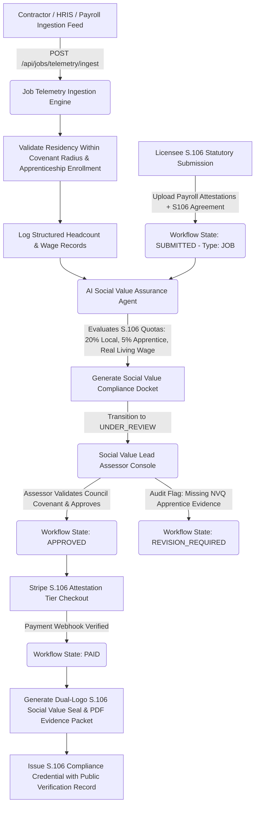

# Workflow 2: Section 106 & Social Value Job Reporting Pipeline

## 1. Executive Summary & Regulatory Foundation
This workflow provides end-to-end statutory job creation and social value verification under:
- **Town and Country Planning Act 1990, Section 106** (Local labor, apprentice quotas, and municipal employment obligations in UK infrastructure and planning consents)
- **Public Services (Social Value) Act 2012** (Mandatory inclusion of social, economic, and environmental well-being in public procurement)
- **UK Living Wage Foundation Standards** (Real Living Wage compliance verification)
- **HM Treasury Green Book & National TOMs (Themes, Outcomes, and Measures)**

---

## 2. Current Source Code Audit & Identified Gaps

| Subsystem | Existing File | Current Implementation | Production-Ready Gap to Close |
| :--- | :--- | :--- | :--- |
| **Job Model** | [`prisma/schema.prisma`](file:///Users/mac/ghg_app/prisma/schema.prisma#L215-L231) | Minimal `JobCreationReport` model (`jobsCreated: Int`, `attestationNote: String`) | Missing `section106CovenantRef`, `localAuthority`, `localWorkersCount`, `apprenticeCount`, `livingWageCompliant`, `localSupplyChainSpendGbp`, `trainingHoursCompleted`, `evidenceDocumentUrl`, `evidenceFileHash` |
| **Assessment Calculator** | [`job-reporting.route.ts`](file:///Users/mac/ghg_app/src/routes/job-reporting.route.ts#L14-L91) | Standalone public benchmark calculator with static scoring | Not integrated with tenant data, nor connected to `WorkflowSubmission` state machine |
| **Report Submission** | [`job-reporting.route.ts`](file:///Users/mac/ghg_app/src/routes/job-reporting.route.ts#L97-L140) | Basic insert into `JobCreationReport` | Missing automated evidence document hashing, S3 upload, and AI review trigger |
| **AI Audit Reviewer** | N/A | None | Must parse payroll summaries, apprenticeships contracts, and residency proofs to verify statutory quotas |
| **Lead Auditor Console** | N/A | None | Lead Auditor / Social Value Assessor console to verify local authority planning covenants and sign off |
| **Credential** | [`credentials.route.ts`](file:///Users/mac/ghg_app/src/routes/credentials.route.ts) | Only wired for `IsoReadinessSubmission` | Must wire dual-logo credential issuance and verification for Job & Social Value credentials |

---

## 3. End-to-End Workflow Architecture

---

## 4. Detailed Feature Breakdown (Implementation Checklist)

### 4.1 Schema Expansion for Statutory Accuracy
- [ ] **Database Migration**: Expand `JobCreationReport` with:
  - `section106CovenantRef`: String (e.g. "S106-CAMDEN-2025-089A")
  - `localAuthority`: String (e.g. "London Borough of Camden")
  - `totalSiteWorkers`: Int
  - `localWorkersCount`: Int (residing within local borough / agreed radius)
  - `apprenticeCount`: Int (formally enrolled in accredited NVQ / apprenticeship programs)
  - `livingWageCompliant`: Boolean
  - `localSupplyChainSpendGbp`: Decimal(12, 2)
  - `trainingHoursCompleted`: Int
  - `evidenceDocumentUrl`: String (encrypted S3 path to payroll summary / affidavit)
  - `evidenceIntegrityHash`: String (SHA-256 hash of evidence document)

### 4.2 Job Telemetry & Contractor Roster Ingestion
- [ ] **HRIS / Payroll Batch Ingestion**:
  - `POST /api/jobs/telemetry/ingest`: Accepts pseudonymized worker records with postal district prefixes (e.g. `NW1`, `E14`), wage tiers, and contract types.
  - Automatically calculates real-time municipal ratios:
    - $\text{Local Labor Ratio} = \frac{\text{Local Workers}}{\text{Total Site Workers}} \times 100\%$ (Target $\ge 20\%$)
    - $\text{Apprentice Ratio} = \frac{\text{Apprentice Count}}{\text{Total Site Workers}} \times 100\%$ (Target $\ge 5\%$)
    - $\text{Living Wage Ratio} = \frac{\text{Workers} \ge \text{Real Living Wage}}{\text{Total Site Workers}} \times 100\%$ (Target $100\%$)

### 4.3 AI Social Value Audit Screener (`AiJobAssuranceReviewer`)
- [ ] **Cross-Verification Agent**:
  - Extracts parameters from uploaded Section 106 Planning Agreement PDF.
  - Cross-references reported figures against contractor payroll summaries.
  - Performs anomaly detection: checks for duplicate worker IDs or improbable training hours.
  - Outputs structured audit docket with statutory conformity determination.

### 4.4 Lead Auditor Sign-Off & Council-Ready Evidence Pack
- [ ] **Municipal Auditor Console**:
  - Review dashboard highlighting compliance against the specific local authority's Section 106 covenant clauses.
  - Single-click export of Section 106 Compliance Attestation PDF with embedded QR verification code for local planning officers.

### 4.5 Dual-Logo Credentialing
- [ ] Issue a dual-logo credential bearing the licensee's crest and municipal social impact details, with a public verification record.
