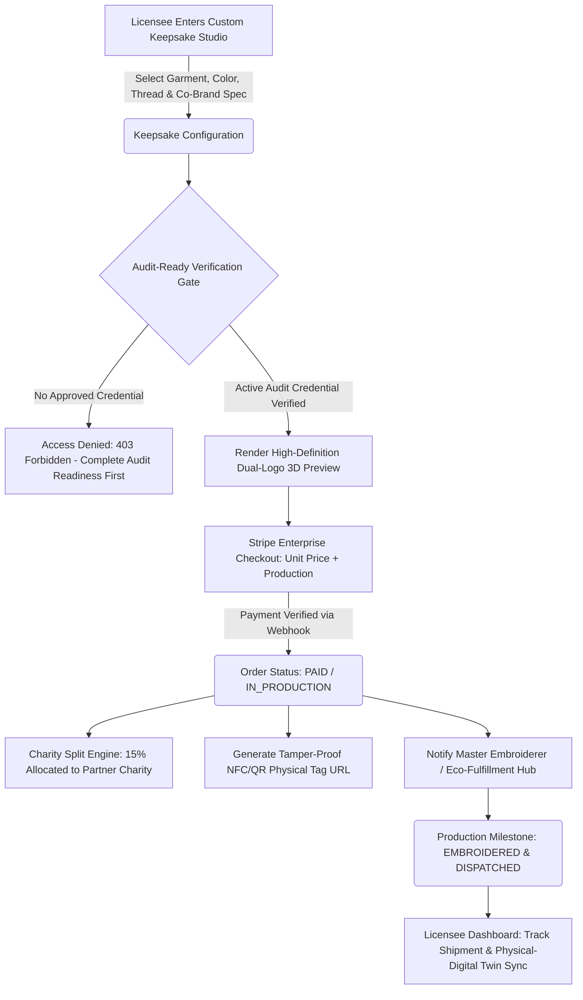

# Workflow 3: Merch & Custom Keepsake Pipeline (Audit-Ready Gated)

## 1. Executive Summary & Gating Philosophy
In enterprise SaaS and environmental governance, merchandise must never be an open novelty e-commerce shop. Custom co-branded merchandise (e.g. embroidered milestone jackets, sustainable organic keepsakes, physical twin badges) is **strictly gated**:
- **Audit-Ready & Paid Precondition**: A licensee can only order custom merchandise containing co-branded seals once their audit-readiness has been evaluated, approved by the Lead Auditor, and their primary assurance tier paid.
- **Charity Royalty Split**: Every merchandise transaction automatically allocates a mandatory 15% royalty split to vetted UK environmental and social impact charities, cryptographically tracked.
- **Supply Chain Traceability**: Every physical item references the digital audit credential and is certified carbon-neutral.

---

## 2. Current Source Code Audit & Identified Gaps

| Subsystem | Existing File | Current Implementation | Production-Ready Gap to Close |
| :--- | :--- | :--- | :--- |
| **Keepsake Customizer** | [`custom-keepsake.route.ts`](file:///Users/mac/ghg_app/src/routes/custom-keepsake.route.ts) | Custom embroidery spec & pricing calculation | No hard check verifying that the licensee has an approved `AUDIT_READY` or `MINTED` credential before ordering |
| **Order Processing** | [`orders.route.ts`](file:///Users/mac/ghg_app/src/routes/orders.route.ts) | Order creation and Stripe payment handling | Needs middleware check: reject order creation with `403 Forbidden: Licensee Must Possess Active Verified Audit Credential` |
| **Charity Allocation** | [`charity-allocation.service.ts`](file:///Users/mac/ghg_app/src/services/charity-allocation.service.ts) | 15% royalty calculation | Fully working, needs audit trail linkage to specific physical keepsake tracking number |
| **Physical-Digital Twin** | [`nft-minting.service.ts`](file:///Users/mac/ghg_app/src/services/nft-minting.service.ts) | Mints ERC-1155 token | Needs physical NFC/QR code generator linking physical garment badge directly to the on-chain Polygon contract and IPFS metadata |

---

## 3. End-to-End Workflow Architecture



---

## 4. Detailed Feature Breakdown (Implementation Checklist)

### 4.1 Strict Verification Gate Enforcement
- [ ] **Gatekeeper Middleware**:
  - Implement `requireVerifiedAuditCredential` middleware.
  - Query database:
    ```typescript
    const hasValidCredential = await prisma.auditWarrantyCredential.findFirst({
      where: {
        licenseeId,
        status: { in: ['MINTED', 'ACTIVE'] },
        warrantyExpiresAt: { gt: new Date() },
      },
    });
    if (!hasValidCredential) {
      return res.status(403).json({
        error: 'CREDENTIAL_REQUIRED',
        message: 'Only verified and audit-ready licensees with an active credential may order co-branded merchandise.',
      });
    }
    ```
  - Return clear diagnostic UI state guiding unverified clients to Workflow 1 or 2 first.

### 4.2 Custom Keepsake Studio Experience
- [ ] **Dual-Logo Embroidery Renderer**:
  - Automatically loads the licensee's vetted corporate crest alongside the GHG Emission Logs gold audit shield.
  - Real-time stitch simulation (gold thread, silver thread, eco-thread options).
  - Validation of minimum stitch density and vector path geometry.

### 4.3 Automated Charity Royalty Split & Escrow
- [ ] **Automated Split Execution**:
  - When payment confirms, deduct 15% gross profit and credit to designated UK charity ledger.
  - Generate a downloadable `CharityDonationCertificate.pdf` confirming the exact GBP contribution.

### 4.4 Physical-Digital Twin Linkage
- [ ] **QR / NFC Cryptographic Tag**:
  - Every garment receives a sewn woven label with a cryptographically signed QR code linking to `/verify/seal/:hash`.
  - Scanning the badge displays the underlying ISO telemetry, lead auditor sign-off date, and polygon blockchain transaction.
