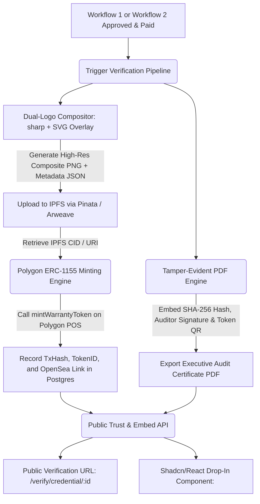

# Workflow 4: Blockchain (ERC-1155), PDF Proof & Embeddable Verification Widget

## 1. Executive Summary & Technological Scope
This workflow provides the immutable verification layer across both Workflow 1 (GHG/ISO Audit-Ready) and Workflow 2 (Section 106 Job Reporting):
- **Polygon ERC-1155 Multi-Token Contract**: Gas-efficient minting of non-fungible warranty credentials and semi-fungible audit milestone badges.
- **Dual-Logo Composite Artwork Engine**: High-fidelity cryptographic visual asset pairing the platform mark with the partner's verified corporate identity.
- **Tamper-Evident PDF Audit Dossier**: Vector-rendered executive report with embedded SHA-256 certificate hashes, auditor signatures, and live blockchain scan links.
- **Drop-in Shadcn/React Verification Component**: Enterprise-grade client-side widget that partners can embed on their corporate websites or investor relations portals to showcase live assurance.

---

## 2. Current Source Code Audit & Identified Gaps

| Subsystem | Existing File | Current Implementation | Production-Ready Gap to Close |
| :--- | :--- | :--- | :--- |
| **Smart Contract** | [`contracts/AuditWarrantyRegistry.sol`](file:///Users/mac/ghg_app/contracts/) | Solidity ERC-1155 contract | Currently only mints carbon assurance tokens; needs schema extension to support Job Reporting / Social Value token types |
| **Minting Service** | [`nft-minting.service.ts`](file:///Users/mac/ghg_app/src/services/nft-minting.service.ts) | Pinata IPFS upload + Web3 mint call | Hardcoded to `IsoReadinessSubmission`; needs to accept generic `WorkflowSubmission` (supporting both `CARBON` and `JOB` streams) |
| **Dual-Logo Engine** | [`dual-logo-composite.service.ts`](file:///Users/mac/ghg_app/src/services/dual-logo-composite.service.ts) | Sharp-based image compositor | Needs responsive aspect-ratio handling and crisp SVG/PNG export for web embedding |
| **PDF Proof Engine** | [`iso-pdf-report.service.ts`](file:///Users/mac/ghg_app/src/services/iso-pdf-report.service.ts) | PDFKit generation for ISO 14064 | Needs dual-purpose rendering: ISO carbon assurance report or Section 106 Social Value statutory report with QR verification |
| **Embed Widget** | [`badge-embed.route.ts`](file:///Users/mac/ghg_app/src/routes/badge-embed.route.ts) | Basic script serving an SVG badge iframe | Needs a modern, installable or drop-in **Shadcn UI React component** (`<AuditTrustSeal />`) with live status verification API |

---

## 3. End-to-End Workflow Architecture



---

## 4. Detailed Feature Breakdown (Implementation Checklist)

### 4.1 ERC-1155 Multi-Token Architecture (`nft-minting.service.ts`)
- [ ] **Dual-Stream Token Minting**:
  - Support two distinct token category IDs:
    - `TOKEN_ID_TYPE_1_CARBON`: ISO 14064-1 & ISO 50001 continuous carbon assurance.
    - `TOKEN_ID_TYPE_2_JOB`: UK Section 106 & Social Value statutory employment compliance.
  - Metadata standard (OpenSea / ERC-1155 compliant):
    ```json
    {
      "name": "Audit Warranty Credential: Urban Infrastructure Partners Ltd",
      "description": "Continuous ISO 14064-1 and UK Section 106 Statutory Compliance Seal issued by NFTY LOGS LABS LTD.",
      "image": "ipfs://QmXyz.../dual_logo_seal.png",
      "external_url": "https://ghgemissionlogs.com/verify/credential/cred_12345",
      "attributes": [
        { "trait_type": "Assurance Framework", "value": "ISO 14064-1 / ISO 50001" },
        { "trait_type": "Social Value Covenant", "value": "S106-CAMDEN-2025" },
        { "trait_type": "Auditor Name", "value": "Lead Assurance Officer, GMC, LL.B." },
        { "trait_type": "SHA-256 Fingerprint", "value": "a4f8c92..." },
        { "trait_type": "Validity Status", "value": "ACTIVE" }
      ]
    }
    ```

### 4.2 High-Resolution Dual-Logo Compositor
- [ ] **Composite Generation**:
  - Take partner's uploaded vector or high-res PNG logo.
  - Normalize dimensions, perform transparent canvas centering, and composite against the GHG Emission Logs gold trust border.
  - Stamp cryptographic verification hash along the lower perimeter.

### 4.3 PDF Proof Generation (`iso-pdf-report.service.ts`)
- [ ] **Enterprise Audit Certificate**:
  - Full vector layout with corporate header, licensee name, audited time horizon, and verified metrics (e.g. Scope 1/2 tCO2e or local jobs created).
  - Dynamic QR code pointing to both the internal verification URL and the PolygonScan transaction URL.
  - Cryptographic digital hash block at footer.

### 4.4 Drop-In Shadcn/React Component (`<AuditTrustSeal />`)
- [ ] **React Component for Client Websites**:
  - Deliver a modern, accessible Shadcn UI component that clients can copy and paste into their Next.js, Vite, or React web apps:
    ```tsx
    import { AuditTrustSeal } from "@/components/compliance/audit-trust-seal";

    export default function InvestorRelationsPage() {
      return (
        <AuditTrustSeal 
          credentialId="cred_urban_infra_2026"
          variant="floating-card" // or "minimal-badge", "pill"
          theme="dark"
        />
      );
    }
    ```
  - Displays real-time status: fetches `/api/credentials/verify/:id` to show live assurance status, ISO clauses passed, and on-chain verification link.
